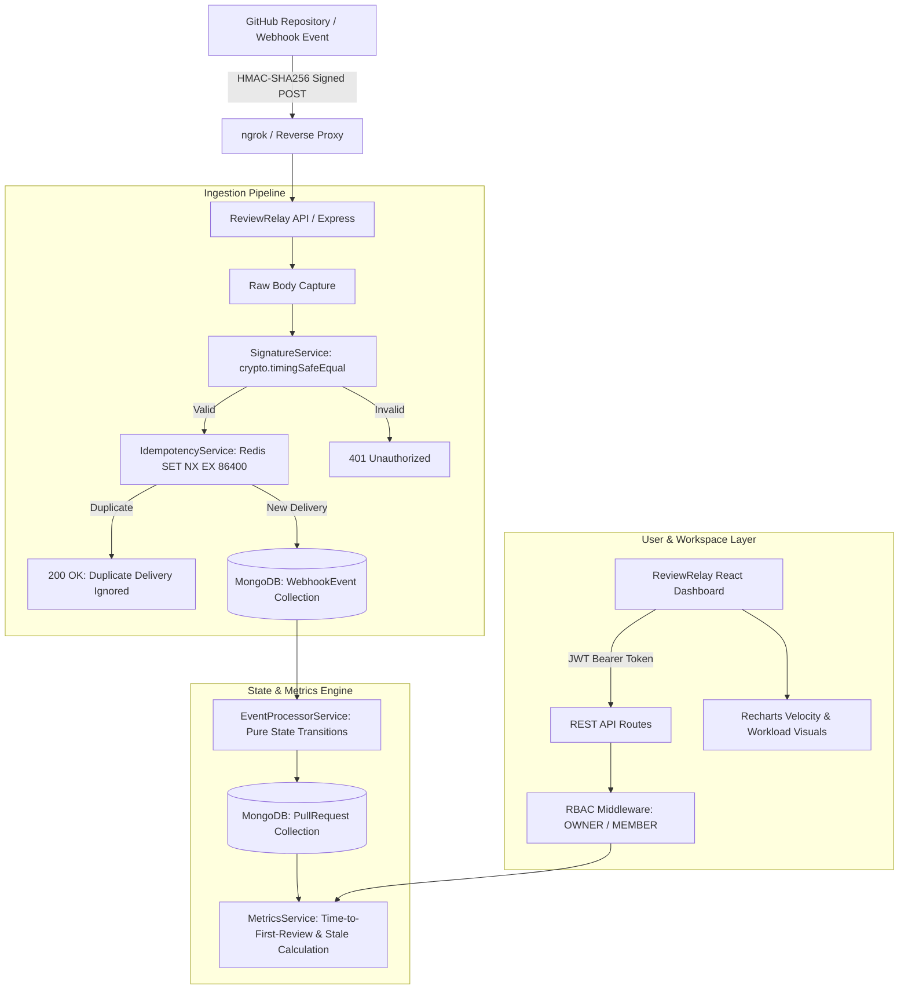

# ReviewRelay — Engineering Intelligence Platform

> Pull request intelligence and review velocity analytics for engineering organizations.

---

## 1. Overview & Problem Statement

Modern development teams often maintain dozens of active pull requests across multiple repositories. However, standard GitHub dashboards provide poor visibility into review bottlenecks:
- **Delayed First Reviews**: PRs sit unassigned or unreviewed for days without awareness.
- **Stale PR Drift**: Pull requests decay in review queues, leading to merge conflicts and context-switching overhead.
- **Review Fatigue & Unbalanced Workloads**: Certain senior engineers absorb an unfair proportion of reviews while others remain unassigned.
- **Missing Velocity SLA**: Engineering leaders lack objective percentiles (Avg, Median, P90) on code review turnaround times.

**ReviewRelay** connects to real GitHub repositories via cryptographically verified webhooks (`HMAC-SHA256`), maintains granular PR lifecycles in real-time, calculates waiting time and configurable stale status, and presents an engineering command center inspired by Linear's restrained aesthetic and GitHub's practicality.

---

## 2. Architecture



---

## 3. Tech Stack

- **Frontend**: React 18, TypeScript, Vite, React Router v6, Tailwind CSS, Recharts, TanStack Query, Lucide Icons.
- **Backend**: Node.js, Express, TypeScript, Mongoose (MongoDB 7.0), ioredis (Redis 7.2), Zod, jsonwebtoken, bcryptjs.
- **Security**: HMAC SHA-256 webhook signatures with `crypto.timingSafeEqual`, Redis idempotency deduplication (`SET NX EX 86400`), Refresh token rotation with bcrypt hashing.
- **DevOps**: Docker, Docker Compose, Vitest, Supertest, GitHub Actions CI.

---

## 4. Design Philosophy

ReviewRelay adheres to a strict, restrained **developer tool aesthetic**:
- **Palette**: Monochromatic neutrals (charcoal, graphite, pure black `#0E1015`, warm white `#EDEDEF`) with a single restrained **ochre/dark yellow accent** (`#C68B18`).
- **No AI Slop**: No excessive glowing cards, no purple/blue gradients, no glassmorphism, no oversized cartoonish pills.
- **Information Density**: Compact tables with precise alignment, monospace PR numbers (`#142`), small semantic status indicators (`● Healthy`, `● Waiting`, `● Stale`).
- **Dark & Light Mode**: Seamless toggle between sleek dark IDE mode and clean editorial light mode.

---

## 5. Local Quickstart

### Prerequisites
- Node.js >= 20.x
- Docker & Docker Compose (optional for standalone execution, required for containerized stack)

### 1. Clone & Install Dependencies
```bash
git clone <repo-url>
cd reviewrelay
npm install
npm run build --workspace=@reviewrelay/shared
```

### 2. Environment Variables
Copy `.env.example` to `.env`, then replace each `generate-a-unique...` value with a separate random secret. Do not commit `.env` or reuse a GitHub, database, or JWT password as an application secret:
```bash
cp .env.example .env
```
The checked-in example contains placeholders, not usable secrets. GitHub OAuth remains disabled until you add an OAuth app's client ID and client secret.

### 3. Start Database & Cache
Using Docker Compose:
```bash
docker compose up -d mongodb redis
```

### 4. Start Development Servers
In separate terminals or using the root workspaces script:
```bash
# Terminal 1: Backend API (port 4000)
npm run dev:api

# Terminal 2: Frontend Web (port 5173)
npm run dev:web
```

Visit **http://localhost:5173** in your browser. Click **"Demo Workspace"** or **"Instant Demo Access"** to immediately explore the platform with zero friction!

---

## 6. Local REST Development vs. GitHub Webhook Delivery

For ordinary local development, you do **not** need ngrok:

1. Start MongoDB and Redis with Docker Compose.
2. Run the backend on `http://localhost:4000`.
3. Run the Vite frontend on `http://localhost:5173`.
4. Use the Vite `/api` proxy for REST calls, OAuth callback testing, repository sync, and dashboard work.

Genuine GitHub webhook delivery is different: GitHub must be able to reach the webhook URL from the public internet. For real deliveries, use a deployed backend, a reverse proxy, or a temporary tunnel such as ngrok.

## 7. GitHub Webhook Integration

### Step 1: Expose the Webhook Endpoint
For genuine GitHub webhook deliveries, expose port 4000 with a public URL. One local option is ngrok:
```bash
ngrok http 4000
```
Copy your forwarding URL (e.g. `https://abc1234.ngrok-free.app`).

### Step 2: Configure Webhook in GitHub Repository
1. Navigate to your GitHub repository: **Settings → Webhooks → Add webhook**.
2. **Payload URL**: `https://<your-ngrok-domain>/api/webhooks/github`
3. **Content type**: `application/json`
4. **Secret**: use a unique random secret configured for this repository in ReviewRelay. Keep it private.
5. **Which events would you like to trigger this webhook?**:
   - Select **Let me select individual events**
   - Check **Pull requests**
   - Check **Pull request reviews**
6. Click **Add webhook**.

### Step 3: Connect the Repository in ReviewRelay
1. In the ReviewRelay dashboard, go to **Settings → Connected Repositories**.
2. Click **Connect Repository**.
3. Input your repository's full name (e.g. `owner/repo`) and numeric GitHub Repository ID.
4. ReviewRelay will now ingest every PR open, review, and merge event in real time!

---

## 8. Webhook Simulation & Testing

To test the HMAC signature verification, Redis deduplication, and stale detection pipeline locally without ngrok, run the built-in simulator:

```bash
# Simulate PR Opened (>50h ago -> becomes Stale)
npm run simulate:pr

# Simulate a fresh PR (<4h ago -> Healthy)
npm run simulate:fresh

# Simulate a requested reviewer
npm run simulate:requested

# Simulate a submitted review (records timeToFirstReview)
npm run simulate:review
```

---

## 9. Running Automated Tests

ReviewRelay includes a comprehensive Vitest test suite covering:
- Timing-safe HMAC-SHA256 signature verification & forged payload rejection
- Redis deduplication and idempotency lock testing
- Pure state transitions (`EventProcessorService`)
- Time-to-first-review single-write guarantees
- Dynamic stale PR calculation with configurable SLA thresholds
- Integration tests on `/api/webhooks/github`

Run the test suite:
```bash
npm run test
```

Typecheck all packages:
```bash
npm run typecheck
```

---

## 10. Docker Compose Full-Stack Deployment

Run the local containerized stack (API + Nginx Frontend + MongoDB + Redis):
```bash
docker compose up --build
```
- Frontend: `http://localhost:5173`
- Backend API: `http://localhost:4000`

For deployment, use `docker-compose.prod.yml` instead. It requires your own authenticated MongoDB URI with TLS (`mongodb+srv://` or `tls=true`), your own password-protected Redis URL with TLS (`rediss://`), and your own GitHub OAuth app credentials. Supply those values through your deployment platform's secret manager, set the OAuth callback and app origin to your HTTPS domain, keep the web container behind an HTTPS reverse proxy, and do not deploy the development database containers from `docker-compose.yml` as your production data store.

The production Compose file fails to start if required credentials are missing. It does not include a database volume, GitHub owner, or fallback production secrets.

## 11. Deploy to Vercel

This repository can deploy the Vite dashboard as static output and the Express API as a Vercel Function on the same origin. The API uses Vercel's Node.js runtime and keeps MongoDB and Redis as external managed services.

1. Push this repository to GitHub. In Vercel, import the repository and leave **Root Directory** set to the repository root.
2. Add the environment variables below in Vercel's Project Settings. Use the **Production** environment; set `APP_ENV=production` so the API applies its production security checks.
3. Set the GitHub OAuth app callback URL to `https://<your-vercel-domain>/api/auth/github/callback`. Set `CORS_ORIGIN` to exactly `https://<your-vercel-domain>`.
4. Deploy. Vercel builds the shared workspace and frontend using `vercel.json`; API requests are handled by `api/[...path].ts`.
5. Configure each GitHub repository webhook to `https://<your-vercel-domain>/api/webhooks/github` with the configured webhook secret, and enable Pull requests and Pull request reviews events.

Required Vercel environment variables:

| Variable | Value |
|---|---|
| `APP_ENV` | `production` |
| `MONGODB_URI` | Authenticated MongoDB Atlas URI with TLS enabled |
| `REDIS_URL` | Password-protected TLS Redis URL (`rediss://`) |
| `JWT_ACCESS_SECRET` | Unique random secret, at least 32 characters |
| `JWT_REFRESH_SECRET` | Different unique random secret, at least 32 characters |
| `GITHUB_CLIENT_ID` | GitHub OAuth app client ID |
| `GITHUB_CLIENT_SECRET` | GitHub OAuth app client secret |
| `GITHUB_CALLBACK_URL` | Public HTTPS callback URL shown above |
| `GITHUB_TOKEN_ENCRYPTION_KEY` | Unique random secret, at least 32 characters |
| `GITHUB_WEBHOOK_SECRET` | Unique random secret, at least 32 characters |
| `CORS_ORIGIN` | Public HTTPS Vercel app origin, no trailing slash |

Keep these values in Vercel's environment variable settings. Never put them in `vercel.json`, source files, or GitHub. `.env` files and private key files are ignored by Git; `.env.example` contains placeholders for local setup. GitHub OAuth is required for production sign-in, and the local demo-login endpoint is disabled in production. Vercel preview deployments also need their own configured environment values if you want their API to work.

The local `.env` file is not uploaded by this setup. If any real credential was previously committed or shared, remove it from Git history and rotate it at its provider before deploying.

---

## 12. API Specification

| Method | Endpoint | Description | Access |
|---|---|---|---|
| `POST` | `/api/webhooks/github` | Ingests and verifies GitHub webhook events | Public (HMAC Verified) |
| `GET` | `/api/auth/github` | Initiates GitHub OAuth authorization flow | Public |
| `GET` | `/api/auth/github/callback` | OAuth code exchange and JWT issuance | Public |
| `POST` | `/api/auth/refresh` | Rotates cryptographic refresh token | Public (Rate Limited) |
| `POST` | `/api/auth/dev-login` | Instant demo login for local development | Public (Rate Limited) |
| `GET` | `/api/auth/me` | Fetches authenticated user and organizations | Authenticated |
| `GET` | `/api/organizations` | Lists user organizations | Authenticated |
| `PATCH`| `/api/organizations/:id` | Updates organization stale SLA threshold | Org OWNER |
| `GET` | `/api/repositories` | Lists connected repositories | Org Member |
| `POST` | `/api/repositories` | Connects new GitHub repository | Org OWNER |
| `GET` | `/api/repositories/github/accessible` | Lists repositories accessible to the OAuth GitHub user | Authenticated |
| `POST` | `/api/repositories/sync-github` | Syncs accessible GitHub repositories and PRs into ReviewRelay | Org OWNER |
| `GET` | `/api/pull-requests` | Lists pull requests with stale status & filters | Org Member |
| `GET` | `/api/pull-requests/:id` | Detailed PR view with event timeline & metrics | Org Member |
| `GET` | `/api/analytics/overview` | KPI counters, health breakdown, time series | Org Member |
| `GET` | `/api/analytics/review-speed` | P50, Average, and P90 review speed stats | Org Member |
| `GET` | `/api/analytics/reviewer-workload`| Team review distribution & pending workload | Org Member |

---

## 13. Security Considerations

- **HMAC Signature Verification**: The raw byte stream is captured prior to JSON parsing and compared against the secret using `crypto.timingSafeEqual` to avoid timing attacks.
- **Idempotency**: Webhook deliveries are locked via Redis `SET NX EX 86400` to prevent duplicate processing if GitHub re-transmits events.
- **Refresh Token Rotation**: Refresh tokens are cryptographically generated (40 random bytes), hashed with bcrypt in MongoDB, rotated upon single use, and revoked upon logout.
- **GitHub OAuth Token Storage**: GitHub OAuth access tokens are encrypted before storage and are only decrypted server-side for GitHub API synchronization. Tokens are never returned to the frontend API responses.
- **Resource Authorization**: Every API request checks organization membership and role (`OWNER` vs `MEMBER`) on the server side.
- **Rate Limiting**: Sliding window rate limiter enforced via Redis protects auth and general endpoints against brute-force attacks.

---

## 14. Future Roadmap
- GitHub App integration for automated repository syncing without manual webhook configuration.
- Slack & Microsoft Teams alerting for PRs nearing the stale threshold.
- Predictive review assignment based on historical code ownership.
